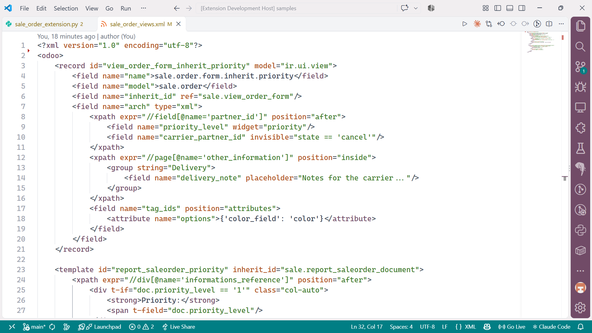

# Odoo Color Theme

Un color theme para desarrolladores de Odoo, inspirado en los colores de marca de Odoo: **morado `#714B67`** y **teal `#017E84`**. Está pensado para el trabajo diario con modelos Python, vistas XML/QWeb y componentes OWL.

> 🎨 Este paquete es **solo el color theme**. Los íconos de archivos (**Odoo Icons**) se publican como una extensión aparte, y habrá un **Odoo Extension Pack** que instale las dos.

## Variantes

| Tema | Base | Descripción |
|---|---|---|
| **Odoo Dark** | `vs-dark` | La variante principal: activity bar morada y status bar teal. |
| **Odoo Light** | `vs` | Inspirada en el backend de Odoo 17. |
| **Odoo Midnight** | `vs-dark` | Un Dark más profundo con tinte morado. |
| **Odoo Community** | `vs-dark` | Dark con los acentos invertidos: el teal es el principal y el morado el secundario. |

## Capturas sugeridas

<!-- Sustituir por las capturas reales antes de publicar:




-->

Antes de publicar conviene preparar estas capturas, todas con los archivos de `samples/` del repositorio:

1. `images/screenshot-dark.png`: **Odoo Dark** con `sale_order_extension.py` abierto y el explorador visible. Deben verse `_inherit`, `fields.Many2one`, `@api.depends` y `self`.
2. `images/screenshot-light.png`: **Odoo Light** con `sale_order_views.xml` (`<xpath>`, `position`, `t-foreach`).
3. `images/screenshot-midnight.png`: **Odoo Midnight** con `order_widget.js` (OWL) y el terminal abierto.
4. `images/screenshot-community.png`: **Odoo Community** con un diff de Git, para mostrar las decoraciones y la status bar.

## Qué se resalta

- **Python / ORM**:
  - keywords, clases, métodos, strings, constantes
  - decoradores `@api.*`
  - `self`/`cls` en itálica
  - `fields.*` y `models.*` como tipos
  - atributos ORM (`_name`, `_inherit`, `_inherits`, `_description`, `_order`, `_rec_name`, `_table`, …) con color propio
- **XML / QWeb**: etiquetas (`<record>`, `<field>`, `<xpath>`, `<template>`), atributos (`name`, `model`, `position`, `expr`, `t-if`, `t-foreach`) y valores.
- **JavaScript (OWL)**, **SCSS** y **Markdown** con la misma paleta.
- **CSV** (`ir.model.access.csv`): VS Code no trae gramática para CSV. Instala [Rainbow CSV](https://marketplace.visualstudio.com/items?itemName=mechatroner.rainbow-csv) y el tema colorea sus columnas con la paleta de Odoo.
- **.po / .pot**: hace falta una extensión de gettext (por ejemplo *gettext* de mrorz). El tema colorea sus scopes genéricos: comentarios, keywords y strings.
- **Semantic highlighting** activado, con colores para Pylance y TypeScript. Las referencias a clases (`fields.Char`, `ValidationError`, `Component`) se pintan como tipos y las declaraciones (`class SaleOrder`) como clases.

### Sobre los atributos ORM

La gramática de Python de VS Code no distingue `_inherit = 'sale.order'` de cualquier otra variable: los dos son un identificador sin scope. Tampoco distingue `fields.Char(...)` de una llamada a función cualquiera.

Por eso la extensión incluye una pequeña **gramática de inyección** (`syntaxes/odoo-python.injection.json`) que asigna scopes propios a esas construcciones:

| Construcción | Scope |
|---|---|
| `_name`, `_inherit`, `_inherits`, `_description`, `_order`, `_rec_name`, `_table` y otros atributos ORM, cuando se asignan al inicio de una línea | `variable.other.constant.orm.odoo` |
| `fields.X`, `models.Model`, `models.TransientModel`, `models.AbstractModel` | `support.type.odoo` |

Limitaciones conocidas:
- La detección es léxica. Una variable que se llame `_name`, aunque no esté dentro de una clase de Odoo, también recibe el color ORM.
- Si importas los campos con otro nombre (`from odoo import fields as f`), `f.Char` no se reconoce.

## Instalación

- **Marketplace**: busca *Odoo Color Theme* en la vista de extensiones (`Ctrl+Shift+X`) o ejecuta `ext install MrKaos.odoo-color-theme`.
- **Open VSX** (VSCodium, Gitpod, Cursor…): busca *Odoo Color Theme* en el registro de Open VSX.
- **Desde un `.vsix`**: `code --install-extension odoo-color-theme-0.1.0.vsix`.

Después abre *Preferences: Color Theme* (`Ctrl+K Ctrl+T`) y elige una de las variantes *Odoo*.

## Personalización

Puedes sobrescribir cualquier color en `settings.json`, solo para una variante o para todas.

```jsonc
{
  // Colores de la interfaz
  "workbench.colorCustomizations": {
    "[Odoo Dark]": {
      "statusBar.background": "#714B67",
      "editor.lineHighlightBackground": "#2E262C"
    }
  },

  // Colores de sintaxis (TextMate)
  "editor.tokenColorCustomizations": {
    "[Odoo Dark]": {
      "comments": "#A39AA1",
      "textMateRules": [
        {
          // Atributos ORM en negrita
          "scope": "variable.other.constant.orm.odoo",
          "settings": { "fontStyle": "bold" }
        },
        {
          // Quitar la itálica de self/cls
          "scope": ["variable.language.special.self.python", "variable.language.special.cls.python"],
          "settings": { "fontStyle": "" }
        }
      ]
    }
  },

  // Colores de semantic tokens (Pylance)
  "editor.semanticTokenColorCustomizations": {
    "[Odoo Dark]": {
      "rules": { "selfParameter": { "fontStyle": "" } }
    }
  }
}
```

Para saber qué scope tiene un token, usa *Developer: Inspect Editor Tokens and Scopes*.

---

## Desarrollo

La extensión vive en un monorepo:

```
palette.json                ← fuente única de colores (tema + íconos)
samples/                    ← archivos de Odoo para probar el tema
packages/odoo-theme/        ← esta extensión
packages/odoo-icons/        ← (próximamente)
packages/odoo-pack/         ← (próximamente)
```

Los JSON de `themes/` **no se editan a mano**: se generan desde `palette.json`.

| Comando (en `packages/odoo-theme`) | Qué hace |
|---|---|
| `npm run build` | Genera los 4 temas desde `palette.json`. No usa dependencias. |
| `npm run check` | Comprueba el contraste WCAG AA (`check-contrast.js`) y valida los temas (`validate-themes.js`). |
| `npm run test:grammar` | Tokeniza `samples/` con las gramáticas de tu VS Code y verifica los colores. |
| `npm test` | Ejecuta build, check y test:grammar. |
| `npm run build:icon` | Regenera `images/icon.png` con los colores de la paleta. |
| `npm run package` | Ejecuta build y check, y genera el `.vsix`. |

`node scripts/check-contrast.js --verbose` muestra todos los pares evaluados. Si alguno falla, el script indica qué nombre de `palette.json` hay que corregir y propone un valor que sí pasa.

### Probar en local (F5)

1. Abre la **carpeta raíz del monorepo** en VS Code y ejecuta `npm install`.
2. Pulsa **F5** y elige la configuración **Run Odoo Theme**. Se regeneran los temas y se abre un *Extension Development Host* con la carpeta `samples/`.
3. En esa ventana, abre *Preferences: Color Theme* y prueba las 4 variantes.
4. Si cambias `palette.json`, ejecuta `npm run build` y recarga la ventana de pruebas (*Developer: Reload Window*).

También puedes lanzarlo sin F5:

```bash
code --extensionDevelopmentPath="$(pwd)/packages/odoo-theme" samples
```

### Publicar

Antes de publicar, añade las capturas en `images/`.

**VS Code Marketplace**
1. Crea un publisher en <https://marketplace.visualstudio.com/manage> con el mismo id que pongas en `publisher`.
2. Crea un *Personal Access Token* en Azure DevOps (organización *All accessible organizations*, scope **Marketplace › Manage**).
3. Ejecuta:
   ```bash
   npx vsce login MrKaos
   npm run package            # genera odoo-color-theme-<versión>.vsix
   npm run publish:vsce       # o: npx vsce publish patch|minor|major
   ```

**Open VSX**
1. Entra en <https://open-vsx.org> con GitHub, firma el *Publisher Agreement* y genera un token en *Settings › Access Tokens*.
2. Crea el namespace una sola vez y publica:
   ```bash
   npx ovsx create-namespace MrKaos -p <token>
   npx ovsx publish odoo-color-theme-0.1.0.vsix -p <token>
   ```

## Licencia

[MIT](LICENSE)
