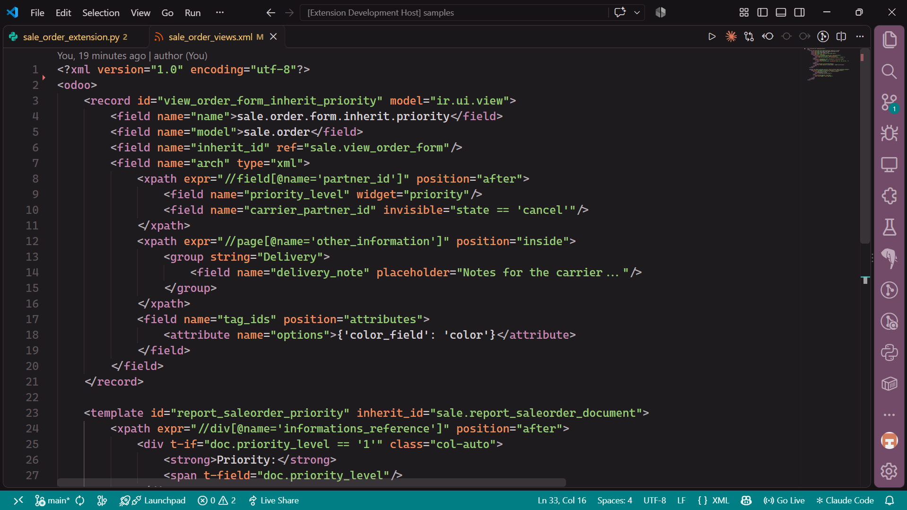
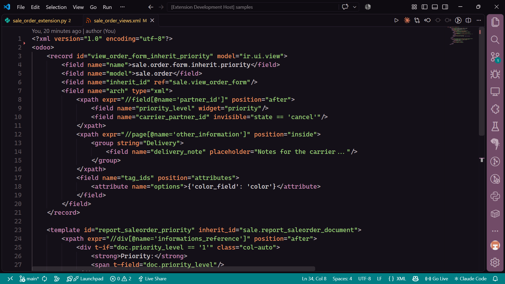
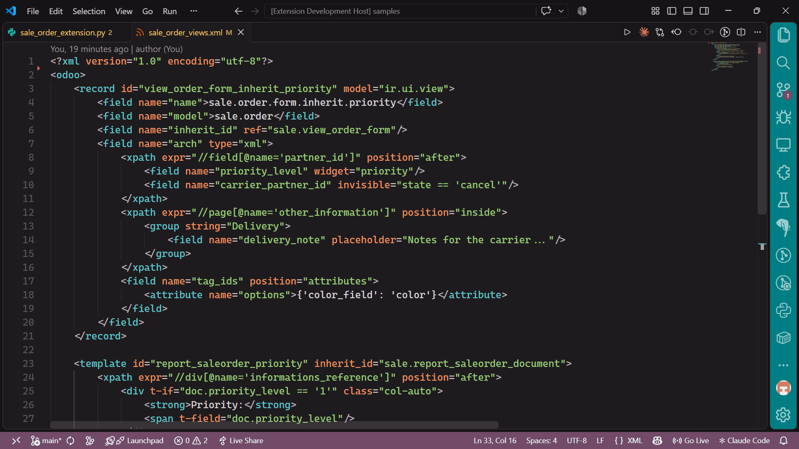

# Odoo Color Theme

**A VS Code theme made for Odoo developers.** It brings Odoo's purple and teal to your editor and highlights Odoo code the way you read it: models, fields, views and OWL components.



## Who it's for

Odoo Color Theme is for anyone who spends the day inside an Odoo addon:

- **Backend developers** writing models, computed fields, constraints and wizards in Python.
- **Functional and technical consultants** customizing forms, reports and QWeb templates in XML.
- **Frontend developers** building OWL components, widgets and SCSS styles.
- **Partners, freelancers and in-house teams** working on Community or Enterprise who want a comfortable, consistent editor that feels at home with Odoo.

If you're used to Odoo's backend, the colors will feel familiar from the first file you open.

## Four variants, one palette

### Odoo Dark
The main theme, shown at the top of this page. A warm dark background with a purple activity bar, a teal status bar and soft, readable syntax colors.

### Odoo Light
A bright theme inspired by the Odoo 17 backend: clean white editor, light gray panels and the same purple and teal accents.


### Odoo Midnight
A deeper, darker take on Odoo Dark with a subtle purple tint. Great for late sessions and OLED screens.



### Odoo Community
Odoo Dark with the accents flipped: teal leads and purple supports.



## Features

### Highlighting that understands Odoo
- **ORM attributes stand out.** `_name`, `_inherit`, `_inherits`, `_description`, `_order`, `_rec_name`, `_table` and friends get their own color, so you can see at a glance what a model is and what it extends.
- **Fields read like types.** `fields.Char`, `fields.Many2one`, `models.Model` and `models.TransientModel` are colored as types, apart from ordinary function calls.
- **Decorators are easy to spot.** `@api.depends`, `@api.onchange`, `@api.constrains` and `@api.model` show in their own color.
- **`self` and `cls` in italics**, so the record you're working on is always easy to find.

### Views, templates and the web client
- **XML views and QWeb**: tags such as `<record>`, `<field>`, `<xpath>` and `<template>`, attributes such as `position`, `expr`, `t-if` and `t-foreach`, and their values each have a distinct color.
- **OWL and JavaScript**, **SCSS** and **Markdown** use the same palette, so every file in your addon looks consistent.

### Comfortable for long sessions
- **Readable by design.** Every text and syntax color meets the WCAG AA contrast guideline against its background in all four variants.
- **Works with Pylance.** Semantic highlighting is enabled and tuned, so the colors stay consistent with Python's language server on.
- **The whole workbench is themed**: sidebar, tabs, menus, notifications, terminal colors, diff and merge views, Git decorations and bracket pair colorization.

## Installation

1. Open the Extensions view (`Ctrl+Shift+X` / `Cmd+Shift+X`).
2. Search for **Odoo Color Theme** and click **Install**.
3. Open **Preferences: Color Theme** (`Ctrl+K Ctrl+T` / `Cmd+K Cmd+T`) and pick **Odoo Dark**, **Odoo Light**, **Odoo Midnight** or **Odoo Community**.

Using VSCodium, Cursor, Gitpod or another editor based on Open VSX? The theme is available on [Open VSX](https://open-vsx.org) too.

## Tips

- **Access rights CSV files** (`ir.model.access.csv`): install [Rainbow CSV](https://marketplace.visualstudio.com/items?itemName=mechatroner.rainbow-csv) and each column is colored with the Odoo palette.
- **Translation files** (`.po` / `.pot`): install a gettext syntax extension to get comments, `msgid` and `msgstr` highlighted.

## Make it yours

Want a different status bar or bold ORM attributes? Override any color in your `settings.json`, just for the Odoo variant you use:

```jsonc
{
  "workbench.colorCustomizations": {
    "[Odoo Dark]": {
      "statusBar.background": "#714B67"
    }
  },
  "editor.tokenColorCustomizations": {
    "[Odoo Dark]": {
      "textMateRules": [
        {
          "scope": "variable.other.constant.orm.odoo",
          "settings": { "fontStyle": "bold" }
        }
      ]
    }
  }
}
```

## Coming soon

- **Odoo Icons**: file icons for Odoo addons (manifests, models, views, security files…), as a separate extension.
- **Odoo Extension Pack**: one install for the theme and the icons.

## Feedback

Found a color that doesn't look right, or a piece of Odoo code that deserves better highlighting? [Open an issue](https://github.com/MrKaos72/vscode-odoo-color-theme/issues). Ideas and contributions are welcome on [GitHub](https://github.com/MrKaos72/vscode-odoo-color-theme).

## License

[MIT](LICENSE)

*Odoo Color Theme is a community project. It is not affiliated with or endorsed by Odoo S.A.*
